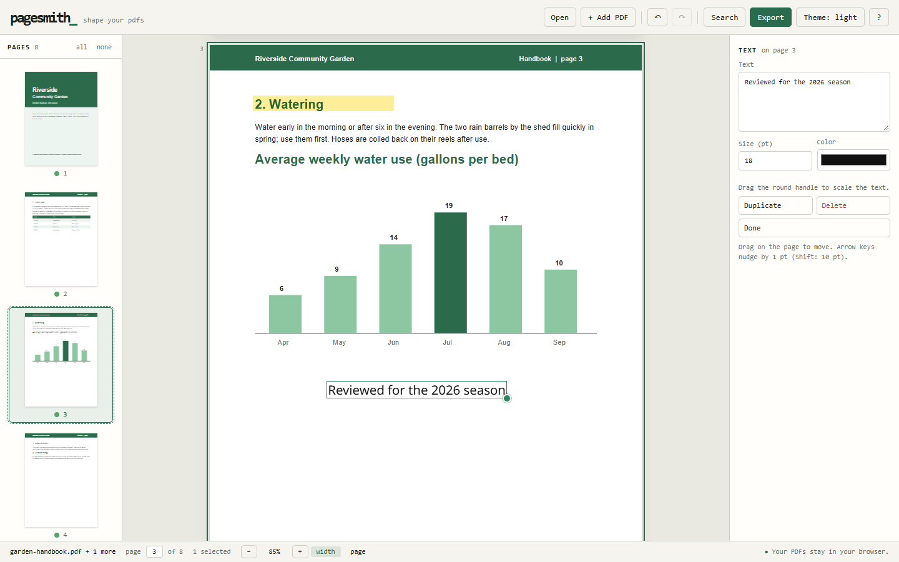
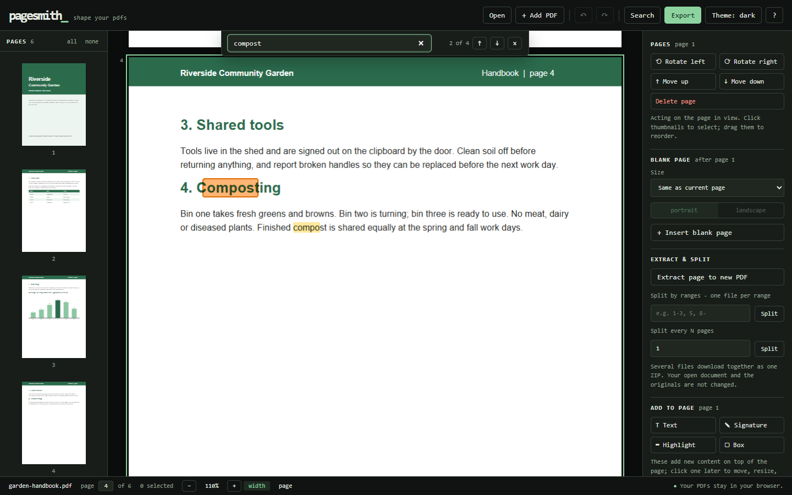
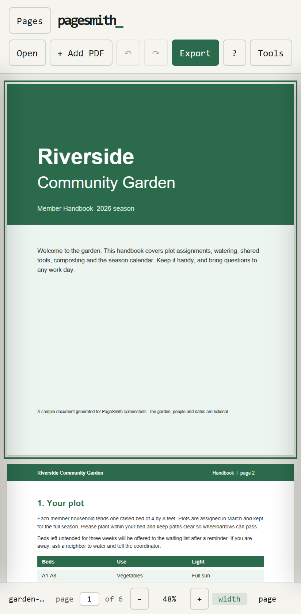

# PageSmith

**Shape your PDFs.** A free PDF toolkit that runs entirely in your browser: merge, split, reorder, rotate, sign, annotate and unlock PDFs. There are no uploads, accounts, watermarks, usage limits or trackers.

> Your PDFs stay in your browser.

PageSmith reads files with the browser's File API and does every step on your device: parsing, rendering, reordering, merging, splitting, annotating and decrypting. It has no backend. Everything is bundled, the production build pins all requests to its own origin with a Content-Security-Policy, and once installed the app works offline.

PageSmith is at version 0.2.0 and under active development.



<p>
  
  
</p>

The sample document in these screenshots was generated for them; its contents are fictional.

## Features

**Open and preview**
- Drag-and-drop, the file picker, or (once installed) "Open with" PageSmith
- Thumbnail sidebar, continuous preview, fit-width / fit-page / 100% / zoom steps
- Page jump (Ctrl+G) and PgUp/PgDn/Home/End navigation
- Text search (Ctrl+F) with highlighted hits. Scanned pages without a text layer are detected and reported (they would need OCR).
- **Password-protected PDFs**: PageSmith asks for the password (RC4-40/128, AES-128 and AES-256 are supported). Files that only carry owner restrictions open only after you confirm you have the right to modify them. Passwords are never stored.

**Organize**
- Reorder by dragging thumbnails with a mouse, by long-press-and-drag on touch screens, with Alt+Up/Down, or with Move up/down
- Rotate, delete, multi-select (Ctrl/Cmd-click, Shift-click, Ctrl+A)
- Insert blank pages: same size as the current page, or Letter / Legal / A3 / A4 / A5 / Tabloid in portrait or landscape (B)
- Undo/redo for every page and overlay change, including touch moves and resizes

**Merge, split, extract**
- Add PDFs with mixed page sizes and reorder pages across files
- Extract the selected pages; split by ranges (`1-3, 5, 8-`) or every N pages
- Splits that produce several files download as one ZIP (stored, not recompressed)
- Long builds show progress and can be canceled

**Overlays**: text, signature images (PNG/JPEG), highlights and boxes
- Select any overlay later to move it (drag or arrow keys), resize it (round handle; text scales its font size), recolor it, edit its text, duplicate it (Ctrl+D) or delete it
- Text uses the bundled **Noto Sans** font in both the editor and the exported PDF, so on-screen placement matches the export
- Supported scripts: Latin, Greek, Cyrillic and Vietnamese. Other characters are flagged before export.
- Overlays stay attached to their page through reordering and rotation, and export upright where they were placed

Overlays add **new** content on top of a page. Editing a PDF's existing text, or its own annotations, is not supported.

**App**
- Installable (PWA) and fully offline after the first visit
- Updates download in the background and wait for you to click **Reload**. Unexported work triggers a confirmation; nothing reloads on its own.
- Light/dark/system themes and a full keyboard shortcut list (press `?`)
- Responsive layout with drawers on tablets and phones
- The About dialog links to the license, the third-party notices (both ship with the app) and the source code

## Privacy

- Document contents are never uploaded, logged, or written to storage, and passwords are never stored. The only thing PageSmith saves is your theme choice.
- Only the page canvas is rendered (no annotation, link or XFA layers), so scripts and links embedded in a PDF never run. pdf.js's scripting sandbox is not even shipped.
- Exports get a fresh document catalog, with no document JavaScript or OpenAction. Page `/AA` actions are removed.
- Untrusted strings reach the page only through `textContent`. Colors are validated, and images are type-checked by their magic bytes.
- Encryption is never silently ignored. Unlocked documents are decrypted in memory only, and the app tells you that exports are not password-protected.

## Run it locally

Requires Node 20 or newer. The browser tests use the installed Google Chrome.

```sh
npm install
npm run dev          # http://localhost:5173 (no service worker or CSP in dev)
npm run build        # type-check + production build into dist/
npm run preview      # serve dist/ on http://localhost:4173 (real PWA, offline and CSP behavior)
```

`dist/` is a static site. Serve it over HTTP(S); opening `index.html` from disk does not work, because module workers and service workers need HTTP.

### Tests

```sh
npm test             # unit tests and independent-reader checks (Vitest)
npm run test:e2e     # browser tests, desktop and mobile (Playwright; run npm run build first)
npm run test:perf    # 100/300/500-page and 55 MB timing runs, written to test-results/perf.json
```

The independent-reader checks re-read exports with PDFium (as WebAssembly) and Xpdf's `pdftotext`. `pdftotext` must be on your PATH; without it those checks are skipped, not failed. Test PDFs are generated by the suites, so no sample documents are stored in the repository.

## How it works

```
src/
  engine/      Document model, loading and decryption (pdf-lib fork), blank pages, ranges, names
  commands/    Pure page/overlay commands (DocState -> DocState) and snapshot undo/redo
  overlay/     Overlay types and view/page geometry (all rotations, crop boxes)
  export/      Export pipeline (copyPages, rotation, overlays, Noto Sans subsetting), ZIP, font coverage
  worker/      Engine Web Worker and its typed client: open, build, zip, blank, checkText, progress, cancel
  render/      pdf.js preview rendering (in its own worker), text extraction, search matching
  ui/          DOM UI, PWA install/update/file launch, theme preference, downloads
  sw-template.js   Service worker; the build fills in the precache list and a content-hash version
tests/
  fixtures.ts  Generated PDFs: mixed sizes, rotated, scanned, 100-500 pages, 55 MB, qpdf-encrypted
  readers.ts   Independent readers: PDFium (WebAssembly) and Xpdf pdftotext
  unit/        Engine, commands, geometry, export, fonts, search, independent-reader checks
  e2e/         App flows, tools, mobile/touch, PWA/offline/update, performance
```

**The PDF engine is separate from the interface.** `engine/`, `commands/`, `overlay/` and `export/` never touch the DOM; they run in the engine worker in the browser and directly under Node in the unit tests.

**Threads.** All pdf-lib work (parsing, decrypting, building, zipping) runs in a dedicated engine worker, which reads each file straight from its `File` handle. pdf.js renders in its own worker; the page reads the file once more and transfers that buffer to pdf.js. A finished export comes back to the page only to be handed to the browser as a download. pdf-lib is not in the main bundle (494 KB, 149 KB gzipped).

**Performance** (a Windows desktop PC, Chrome, production build):

| Document | Open | Jump to last page | Export | UI tasks over 50 ms during export |
|---|---|---|---|---|
| 100 pages | 0.22 s | 0.07 s | 0.04 s | none |
| 300 pages | 0.28 s | 0.10 s | 0.10 s | none |
| 500 pages | 0.36 s | 0.10 s | 0.16 s | none |
| 120 pages, 55 MB of images | 0.30 s | 0.03 s | 0.10 s | none |

## Known limitations

- **Overlay text:** CJK, Hebrew, Arabic, Indic and other scripts that need shaping are not supported; they export as `?`, and the panel says so before export.
- **Existing PDF content:** existing text and existing annotations can't be edited. Form fields copied from merged files can lose their form binding.
- **Exports aren't re-encrypted:** an unlocked file is exported without a password.
- **Search:** matches within a single text run, so phrases split across lines or runs aren't found. Hit boxes are proportional estimates, and scanned pages need OCR (not included).
- **Files larger than 512 MB are rejected.**
- **Reordering in the main preview:** you can't drag pages there; reorder in the thumbnail sidebar instead.
- **Browsers:** the automated tests run in Google Chrome on desktop and in Chrome's Android phone emulation, and the main flows have been checked in Firefox 158. Safari and real mobile devices have not been tested yet.

## Roadmap

Planned next, roughly in order:

1. **Password-protect exports**, so a file that was unlocked can be saved with a password again.
2. **Keep form fields working when merging** files that contain fillable forms.
3. **Better search**: phrases that span lines or text runs, with exact highlight boxes.
4. **Drag to reorder in the main preview**, not just the thumbnail sidebar.
5. **Testing beyond Chrome**: automated Firefox and Safari runs, and real phones.
6. **CJK overlay text** with an optional font download (about 16 MB per language, fetched only when needed).
7. **OCR for scanned pages**, as an optional download.
8. **Right-to-left and Indic overlay text**, which needs a text-shaping engine.

## License

Copyright (C) 2026 RadMageIRL

PageSmith is free software: you can redistribute it and/or modify it under the terms of the GNU General Public License, version 3 only (GPL-3.0-only). See [LICENSE](LICENSE).

PageSmith is built with third-party software under its own licenses (mainly MIT and Apache 2.0) and bundles the Noto Sans font (SIL Open Font License 1.1). See [THIRD-PARTY-NOTICES.txt](THIRD-PARTY-NOTICES.txt).
